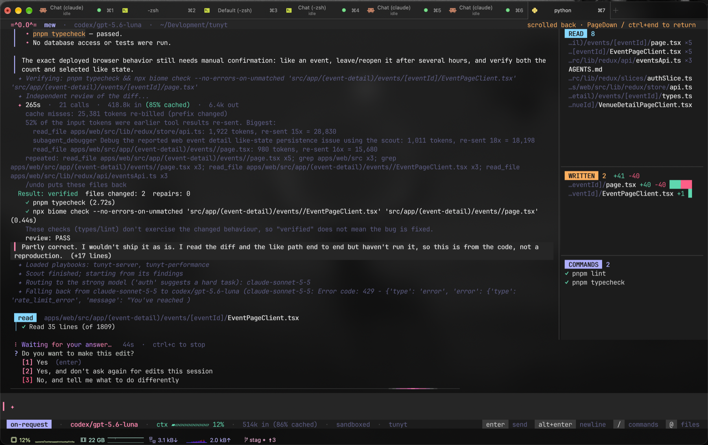
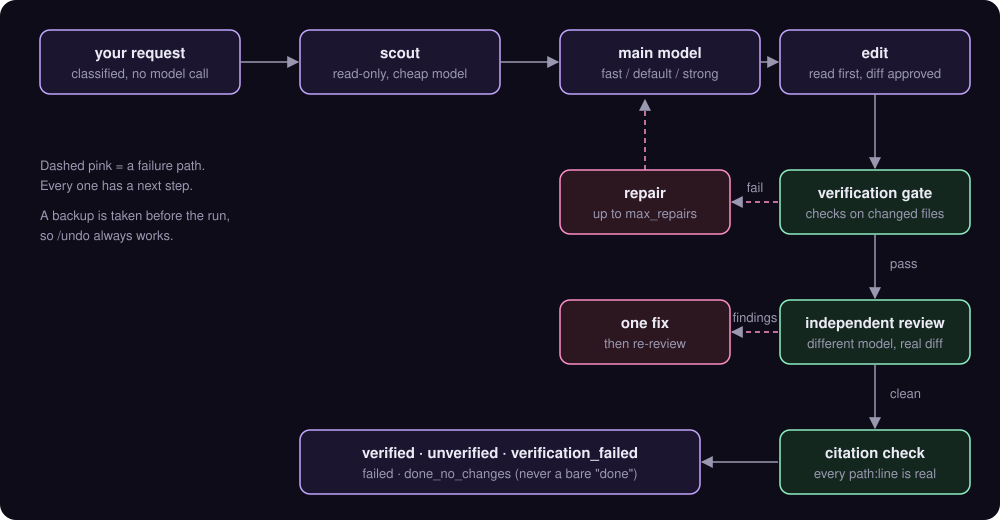

<p align="center">
  
</p>

<p align="center">
  
  
  
  
</p>

<p align="center">
  <a href="#quick-start">Quick start</a> ·
  <a href="#how-a-request-flows">How it works</a> ·
  <a href="#speed-and-token-savings">Token savings</a> ·
  <a href="#correctness-verify-review-ground">Correctness</a> ·
  <a href="#safety">Safety</a> ·
  <a href="#not-there-yet">Not there yet</a>
</p>

# mew

**The coding agent that proves its work.**

Most agents tell you they are done. mew shows you: the checks that passed, a second model's review of the real diff, and every
file reference in the answer checked against your tree. Underneath, one rule: **every token and every tool call should earn its place.**

mew is a terminal harness that works with Claude, GPT/Codex, DeepSeek and anything else behind an OpenAI-style API. It is fast on
big repos because it finds code before it reads it, cheap because it never sends the same thing twice, and safe because its
guardrails live in code, not in a prompt asking the model to behave.

| Fast | Cheap | Honest | Safe |
|---|---|---|---|
| search and scout before reading | incremental reads, diffs, caching that hits | verify, review, citation check | confined tools, OS sandbox, project trust |

<p align="center">
  
</p>

A real session, not a mock-up. What you are looking at:

- **Routing and failover, out loud.** The request was judged hard and sent to the strong model; that provider hit a rate limit, and
  mew said so and fell back to another model instead of dying.
- **Cost report after the run.** 21 calls, 85% of input cached, and a breakdown showing which earlier tool results were re-sent
  the most, so you know what to fix.
- **Honest verification.** Result is `verified` with typecheck and lint passing, and mew adds that these checks do not exercise
  the changed behaviour, so "verified" does not mean the bug is fixed. The independent review ran, and the final answer says
  it is from reading the code, not a reproduction.
- **Side panel.** Files read (with re-read counts), files written with lines added and removed, commands run.
- **Approval prompt** with three choices, the footer showing mode, model, context bar, cache rate and `sandboxed`.

## Why it is different

Most harnesses make the model do the hard parts and then hope. mew moves the hard parts into code the model can't skip.

| Problem every agent has | What most do | What mew does |
|---|---|---|
| Finding the right file | grep around, read a lot | BM25 `search`, `outline`, symbol reads, and a read-only **scout** that reports back before the main model starts |
| Re-reading files | send the whole file again | a per-file map of lines already in context; a changed file comes back as a **diff**, an unchanged one costs almost nothing |
| Context filling up | summarize everything at 90% | keep the newest ~20k tokens verbatim, fold only older turns into a running summary, prune stale tool output inside a task |
| Model says "done" | trust it | **verification gate**, then an **independent reviewer** on a different model reads the real diff |
| Model invents a file or line | nothing | every `path:line` in the answer is checked against the tree, one correction round, leftovers shown as warnings |
| Safety | "please don't touch ~/.ssh" in the prompt | confined file tools, path-scanning shell, and an OS sandbox |
| Provider quota hits | the session dies | fails over to another provider and says so out loud |
| A bad edit | `git checkout` and hope | pre-run backup and `/undo` |

## How a request flows

<p align="center">
  
</p>

Every step that can fail has a defined next step. Nothing ends in "the model said it was fine".

## Contents

- [Quick start](#quick-start)
- [Speed and token savings](#speed-and-token-savings)
- [Finding code without reading everything](#finding-code-without-reading-everything)
- [Correctness: verify, review, ground](#correctness-verify-review-ground)
- [Safety](#safety)
- [Models and routing](#models-and-routing)
- [Parallel agents](#parallel-agents)
- [Interactive UI](#interactive-ui)
- [Memory that cannot hallucinate](#memory-that-cannot-hallucinate)
- [Skills, subagents, profiles](#skills-subagents-profiles)
- [Extending: MCP and hooks](#extending-mcp-and-hooks)
- [Tests and benchmarks](#tests-and-benchmarks)

## Quick start

```bash
uv venv .venv && uv pip install --python .venv/bin/python -r requirements.txt
echo 'API_KEY=...' > .env            # BASE_URL defaults to https://api.commandcode.ai/provider/v1
.venv/bin/python main.py                                      # interactive
.venv/bin/python main.py -m claude-haiku-5-5 --approval auto "your task"   # one shot
```

Using a ChatGPT/Codex login instead of an API key? `-m codex/<model>` reads and refreshes the login the Codex CLI already stored.
No key needed.

## Speed and token savings

The cheapest token is the one never sent. These are all on by default.

- **Tiny system prompt.** About 0.7k tokens (it was ~3k). Always-on skills add about 450 more.
- **Prompt caching that actually hits.** Claude calls cache the system prompt and the conversation prefix. The Codex backend only
  caches when `session_id` and `prompt_cache_key` are sent, so mew sends both. If a model is not caching, it warns you, and
  `/cost` says why a miss happened (idle gap, model changed, prefix changed).
- **Incremental reads.** `read_file` remembers which lines the model has already seen and returns only the new ones. If the file
  changed since, you get a diff against the last copy the model saw, not the file again.
- **Tool output caps.** Over-broad `grep` results collapse into a summary, missing paths suggest real files, and every tool result
  is capped (`tool_output_max_chars`).
- **Pruning inside a task.** Old tool results are dropped (newest 20k tokens kept) with a hint of what was cleared, so a long
  investigation does not drag its own history.
- **Smart compaction.** The newest ~20k tokens stay verbatim; only older messages fold into a running summary, plus a
  deterministic list of files read and modified, so nothing important is a paraphrase.
- **Cost-weighted accounting.** Each tool result is weighted by how many later calls re-send it, so `/cost` points at the thing
  actually worth fixing. It only shows the breakdown when it is worth acting on.
- **Persistent search index.** Cold index of a large repo: 13.7s. Warm: 1.2s.
- **Budget with a clean ending.** `max_total_tokens` warns at 70% and then makes one last tool-free call so the work done so far
  becomes an answer, not a bare failure.
- **Long commands run in the background.** A shell command still running after 15s moves to a background job and keeps the
  output it already printed. `/jobs` lists, shows and stops them; the model is told when one finishes.
- **No stalls.** A stuck model stream cannot outlive the request's time budget; a hung parallel worker fails after 15 minutes
  instead of blocking its whole layer; sub-agents have a hard timeout that also cuts hung calls.

## Finding code without reading everything

In the order to reach for them, cheapest first:

1. **`search`**: BM25-ranked files for a plain-words query, camelCase-aware, with co-occurrence rerank and noise down-weighting.
2. **`outline`**: symbols and JSX section markers with line ranges (bracket-balanced, so huge components don't blow up).
3. **`read_file(path, symbol=...)`**: one function, not the file.
4. **`git`**: read-only `blame`, `log`, and `find_change` (`git log -S`) to answer "when did this break".
5. **`graph`**: structure questions (callers, callees, path, community) answered from a graphify graph. Call
   direction is read from the source text because graph edge order is unreliable, and results say how stale the graph is.
6. **`grep` / `glob`**: for exact strings. They respect `.gitignore`, find dotfiles, never touch secrets, and use smart-case.

A non-trivial request starts with a **scout**: a read-only investigator on a cheap model, so the main context begins from
findings instead of searches. The prompt also teaches hypothesis-first investigation and divergence-based bug finding: find
where the real behaviour differs from the expected one, instead of reading in circles.

## Correctness: verify, review, ground

A run that changes files is not `verified` until it passes, in order:

1. **Verification gate.** `verify_commands` or per-path `[[verify_rules]]` (`{files}` = changed files, `{tests}` = related web unit
   specs). pytest, go and cargo are auto-detected. Failures go back to the model as a repair request (`max_repairs`, default 2),
   and a repaired change is reviewed again.
2. **Independent review** (`auto_review = true`). A read-only reviewer on a *different* model reads the real diff, with search,
   outline and git available. Small diffs get a short review. The reviewer tests the author's stated root cause against the code,
   and says so when passing checks do not actually exercise the change. When it runs out of turns it gives a verdict instead of
   failing to parse.
3. **Grounding.**
   - *Read before edit:* editing a file the agent has not read this session is refused, and so is editing one that changed on
     disk since it was read.
   - *Citation check:* every `path` and `path:line` in the final answer is verified against the real tree. Fabricated files or
     line numbers past the end of a file go back for one correction; anything still unverified is shown as a warning.
   - *Always-on `grounded` rule:* only claim what a tool showed you.

Final status is one of `verified | unverified | verification_failed | failed | done_no_changes`. It is never a bare "done".

Loop detection catches repeating actions and escalates to a stronger model instead of burning budget.

## Safety

Three independent layers, so one bug does not open the door:

1. **File tools** (read, edit, write, list, grep, glob, and the `cwd` of shell) are confined to the folder you started in.
   Paths are resolved first, so `..` and symlinks that point out are refused. Add roots on purpose with `--add-dir`.
2. **Shell commands** are scanned for paths in your home, `/etc`, other users' folders, or `..` escapes, and refused before they
   run. History-destroying git commands are blocked.
3. **OS sandbox** (macOS `sandbox-exec`, on by default). Even a command built dynamically cannot write outside the workspace, temp
   dirs and package caches, or read `~/.ssh`, `~/.aws`, `~/.gnupg` and keychains. `sandbox = "off"` disables it.

Plus:

- `.env*`, `*.pem`, `*.key` and SSH keys are protected by default.
- `web_fetch` refuses localhost, private ranges and cloud metadata at *every* redirect hop (SSRF-safe).
- **Project trust:** a repo's `.ai-agent/config.toml` cannot enable `hooks`, `mcp_servers`, `verify_commands`, `verify_rules`,
  `approval` or `shell_environment` until you trust that exact file (`--trust`). Editing the file revokes the trust. A cloned repo
  cannot quietly turn on code execution.
- **Approvals show a diff** and what you approve is exactly what gets written: preview and write share one planner. Choices are
  yes / yes and don't ask again / no, and tell me what to do differently (your reply goes to the model).
- **Atomic writes** (temp file + rename) for files and sessions, so a kill mid-write never leaves a truncated file.
- **`/undo`:** before each request mew records the working tree as a commit object (`refs/mew/backup`, nothing touches your
  index or stash). `/undo` restores what the last request changed and removes files it created. Untracked files that existed
  before are never deleted.

Approval modes: `on-request` (default), `auto-edit`, `auto`, `never`, `yolo`.

## Models and routing

- Claude models go through `/messages`, everything else through `/chat/completions`, picked from the live `/models` catalog
  (cached 24h). Codex models use the Responses API over SSE with automatic token refresh.
- **Role chains** in `.ai-agent/config.toml`:

  ```toml
  [routing]
  default   = ["claude-sonnet-5-5", "deepseek/deepseek-v4-pro"]
  fast      = ["deepseek/deepseek-v4-flash"]       # easy requests
  strong    = ["claude-opus-5-5"]                  # hard ones, and escalation
  summarize = ["deepseek/deepseek-v4-flash"]       # context compaction
  review    = ["gpt-5.6-sol"]
  ```

- **Difficulty tiers.** Each request is classified without a model call and sent to the right chain. A failed repair or a detected
  loop escalates to `strong`. `-m` or `/model` pins a model.
- **Failover that tells you.** A model that returns not-in-plan/not-found is skipped for an hour. A plan-wide quota on one
  provider fails over to a model on *another* provider and blocks that provider for the session. Your own model is always the
  last resort. Nothing falls over silently.
- `python scripts/probe_models.py --json out.json` shows which models your key can really call.

## Parallel agents

- **Read-only sub-agents** called in the same turn run concurrently under a shared cap (`max_parallel_agents`, default 4) with
  live progress. Failures lead with the reason; a failed scout is announced, not silent.
- **`parallel_tasks`** fans write-capable workers out into separate **git worktrees**, merges them in dependency order into
  `mew/<run>/integration`, detects overlap, re-runs real conflicts on top of the merged state, and flags them for review instead
  of resolving them silently. `--parallel` lets the model plan the split; `--graph tasks.json` is explicit.
  It only pays off for genuinely independent work. Measure before relying on it.

## Interactive UI

A full-screen terminal UI with its own look, not a clone.

- Scrollable conversation, a side panel for files read / written (with lines added and removed) / commands run, a todo checklist,
  an agents panel, and a live status line with phase, elapsed time and tokens.
- Streamed markdown, syntax-highlighted tinted diffs, in-app approvals that disappear once answered.
- The input box grows with wrapped text (up to 40% of the screen), then scrolls. History (Up / Ctrl+R), `/` completion, `@path`
  attachment, `!cmd` shows output to the model (`!!cmd` keeps it private), Alt+Enter for a newline, **Ctrl+C interrupts the
  agent, not the app**.
- Mouse selection (drag, double-click word, triple-click line) copies to the system clipboard and via OSC 52, with `/copy` and
  F2 native-select fallbacks.
- Queued messages say they are queued. `MEW_PLAIN=1` keeps the classic line layout.
- **Resume anything.** Every turn autosaves. Exit prints `mew --resume <id>` and `mew --continue`. `/sessions` lists them,
  `/resume [id]` switches.

Commands: `/help /clear /compact /cost /model /approval /skills /expand /config /stats /tools /mcp /save /sessions /resume
/checkpoint /restore /undo /jobs /copy /learn /lessons /forget /exit`.

## Memory that cannot hallucinate

Per repo, stored outside it. mew only keeps what can't be invented: what *you* told it, and what *verified* runs changed.

- `/learn <rule>`, or rejecting an action with feedback, saves a lesson. Lessons appear in the next session's prompt (newest first,
  capped at 1,500 chars). `/lessons` lists them, `/forget N` removes one.
- Each verified run records its request words and the files it changed, and `search` boosts files that fixed similar requests
  before.
- Instruction files are honoured the way you wrote them: every `AGENTS.md` / `CLAUDE.md` in a directory plus `~/.claude/CLAUDE.md`,
  `@imports` followed, and commit/comment/spec/plan rules kept even when the file is too long to inline. The commit and comment
  rules are re-read before committing.

## Skills, subagents, profiles

- **Skills** are short curated playbooks with `triggers`. Matching ones are attached automatically (keyword match, no model call);
  the model can pull any other with `use_skill(name)` or a single section with `use_skill(name, section=...)`.
  - Always on: `ponytail` (do the least that fully works), `grounded`, `house-rules`.
  - On match: `debugging`, `code-review`, `security`, `refactor`, `testing`, `performance`, `database`, `api-design`, `git-workflow`.
  - Turn one off with `disabled_skills = ["ponytail"]`.
- **Subagents** are declared in a profile (`[[subagents]]`: name, description, goal_prompt, allowed_tools, role). `role` picks a
  routing chain, so exploration runs cheap and debugging runs strong. Sub-agents start no MCP servers and cap answers at 6000 chars.
- **Repo profiles** (`profiles/<name>.toml`): per-project instructions, `forbidden_paths`, `forbidden_commands`, `verify_rules`,
  routing. Forbidden paths and commands are enforced in the tool layer. Auto-selected by path, or `profile = "name"`.

## Extending: MCP and hooks

- **MCP:** stdio and HTTP/SSE servers, their tools show up beside the built-ins. Gated by project trust.
- **Hooks:** scripts before/after agent runs and tool calls, plus error hooks. Also gated by project trust.
- **Built-in tools:** `read_file`, `write_file`, `edit_file` (multi-edit, fuzzy match, CRLF-preserving), `list_dir`, `glob`, `grep`,
  `search`, `outline`, `git`, `graph`, `shell`, `web_search`, `web_fetch`, `memory`, `todo`, `use_skill`, `parallel_tasks`.

## Tests and benchmarks

```bash
.venv/bin/python -m pytest -q                       # 224 offline unit tests
.venv/bin/python -m bench.run --model claude-haiku-5-5 --runs 3 --label mine
.venv/bin/python -m bench.run --mode parallel --model deepseek/deepseek-v4-flash --jobs 1 --runs 3
.venv/bin/python -m bench.run --summarize bench/results/*.json
.venv/bin/python -m bench.tunyt_tasks --clone <scratch clone> --out <dir> --model <model> --tasks <name>
```

Benchmarks hit the real API. Runs that cannot execute (plan, quota, key) are recorded as `blocked`, not as failures. Reports include
a timing breakdown. Real-repo tasks run only in a scratch clone, never in your working copy. Traces: one JSONL per session under
the user data dir (`traces/`).

## Not there yet

Said plainly, so you know what you are getting:

- No plan mode (a read-only phase ending in an approved plan).
- No image input (pasting a screenshot).
- No structured JSON output for CI, and no custom slash-command files.
- The OS sandbox is macOS only; on Linux you get the confined tools and shell path checks, not the kernel layer.
- No reasoning-effort setting, no rewind to an earlier message (`/undo` reverts the last request), no LSP diagnostics, no IDE extension.

### On "better than the others"

The table at the top compares *design choices*, not leaderboard scores. No head-to-head benchmark against other harnesses has been
run, so none is claimed here. The harness ships its own bench so you can measure it on your tasks, with your models.
