<p align="center">
  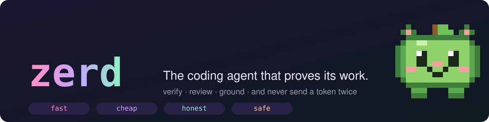
</p>

<p align="center">
  
  
  
  
</p>

<p align="center">
  <a href="#install">Install</a> ·
  <a href="#what-a-run-looks-like">A run</a> ·
  <a href="#the-proof">The proof</a> ·
  <a href="#what-zerd-does-that-others-leave-to-the-model">Capabilities</a> ·
  <a href="#works-with-the-model-you-can-afford">Models</a> ·
  <a href="#safety">Safety</a> ·
  <a href="#reference">Reference</a> ·
  <a href="#where-zerd-is-not-there-yet">Limits</a> ·
  <a href="https://zerd.si">Website</a>
</p>

# zerd

**A terminal coding agent that checks its own work, then shows you the evidence.**

Most agents write a change, say "Done!", and leave you to find out. zerd treats "done" as a claim that has to be backed up.
It runs the project's own checks on the files it touched. It sends the diff to a second agent whose job is to find what's
wrong. It looks up every file and line it mentions on disk. When something doesn't hold, you hear about it in the answer
instead of in production.

It is also built so that **a cheaper model can do real engineering work.** The checking, repairing, searching and remembering
that a frontier model might do on its own are done by the harness, in code, so they don't depend on how good the model is that day.

One native Rust binary. No Python, no Node, nothing to install next to it.

<p align="center">
  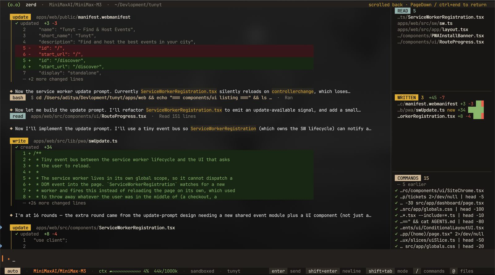
</p>

## Install

```bash
curl -fsSL https://zerd.si/install.sh | sh          # macOS and Linux
irm https://zerd.si/install.ps1 | iex               # Windows 10/11, PowerShell
```

Then, in any repo:

```bash
zerd
```

The first launch walks you through setup in about a minute: pick where models come from (a ChatGPT/Codex login, an Anthropic,
OpenAI, OpenRouter or Gemini key, a local Ollama or LM Studio, or the gateway), paste a key, watch it get checked against the
provider, pick a model. `zerd doctor` checks your credentials, a live provider call, git, the sandbox and your terminal, and
prints the fix next to each problem.

<details>
<summary>Build from source, Windows notes, one-shot use</summary>

```bash
git clone https://github.com/Adityaadpandey/zerd.si && cd zerd.si
cargo build --release                  # target/release/zerd
```

On Windows install [Git for Windows](https://git-scm.com/download/win) first. zerd runs shell commands in its bash, because
models write bash. See [Windows notes](#windows-notes).

One shot, for scripts and CI (checks run automatically in this mode):

```bash
zerd -m claude-haiku-5-5 --approval auto "fix the failing test in tests/test_paging.py"
zerd --continue          # pick up the last session in this folder
```

</details>

## What a run looks like

You ask for a change. What you see is the harness working, not a model narrating. Each status line below is a message zerd
really prints; the sequence is an illustration of one run, put together to show the flow, and the last two lines are a
summary, not the exact format:

```text
> change unique_by() to take a key function and drop the seen= argument

  Routing to the strong model (read by the fast model): claude-opus-5-5
  Verifying: python3 -m pytest -q -x tests/test_unique.py
  Verification failed (python3 -m pytest ...); repair attempt 1/2
  Verifying: python3 -m pytest -q -x tests/test_unique.py
  The change breaks 1 public signature(s) (utils.py: unique_by() no longer accepts `seen`); asking to keep old calls working
  Verifying: python3 -m pytest -q -x tests/test_unique.py
  Independent review of the diff...
  Reviewer found issues; sending them back for a fix
  Independent review of the diff...

  status: verified   checks: 1 passed   review: clean   citations: 4 checked, 0 unverified
  Rounds: 9 used, 10 estimated, +10 points (within the target)
```

Every line there is a decision made by code, not by the model: which checks to run, whether a failure is the agent's or was
already there, whether a public signature broke, whether the review has to go again. The final status is always one of
`verified`, `unverified`, `verification_failed`, `failed` or `done_no_changes`. Never a bare "done".

### The path every request takes

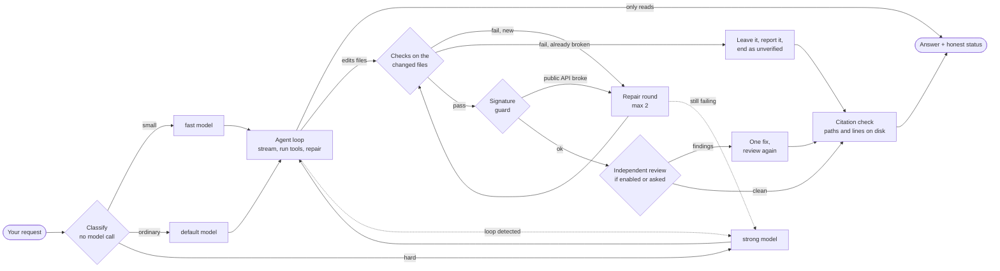

Each request is a task with an explicit lifecycle. Transitions are validated in code, so a run can't jump from `failed` to
`verified`, and every move is written to a trace.

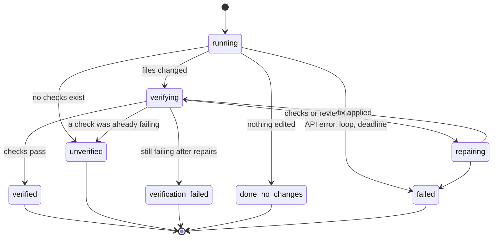

### How it is put together

One rule between the layers: **everything the model can do goes through one door, and everything the harness decides is traced.**

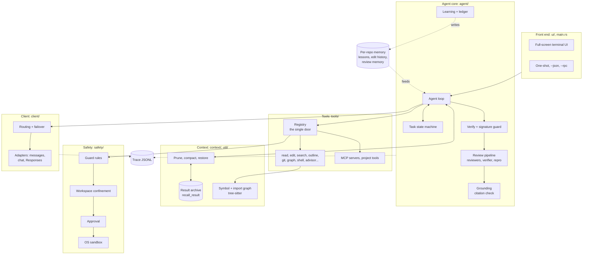

## The proof

### Round 2: the webhook reliability test (zerd on MiniMax M3 vs Claude Code on Sonnet 5.5)

Both agents got the same job on separate branches: build a payment-webhook service (signature check, idempotency, an outbox,
queue workers, retries, dead letters, admin replay), then attack it with the same 15 scenarios. 100 identical webhooks at once.
Two events for one payment. A worker killed mid-job. Redis down. Postgres down. Retries running out. Bad signatures, oversized
bodies, cross-tenant admin calls, out-of-order events, a crash between commit and ack.

The question was not who writes more code. It was **who can show that it works.**

| | zerd (MiniMax M3) | Claude Code (Sonnet 5.5) |
|---|---|---|
| Scenarios with an automated test | **15 / 15** | 14 / 15 (one kept as a known failure) |
| Database | real PostgreSQL (schema-only copy, isolated database) | in-memory repository |
| Queue | real Redis client (DB index 5), outages made by pointing it at dead ports | enqueue made to throw |
| Worker crash | a real child process, **SIGKILL** | lease expiry simulated |
| HTTP | the real Fastify app through `inject` | service layer |
| Concurrency | **25 repeated races** on one payment | `Promise.all` of 100 in memory |
| Real bugs found | **12**, each reproduced or checked directly | 3, each reproduced |
| Commits | 21, one fix each | n/a |

What zerd found by running against the real thing:

- Unquoted camelCase SQL identifiers, so **no webhook ever persisted.**
- A **lost update** under concurrency that left a captured payment marked `FAILED` (fixed with row locking and a transaction).
- Retries scheduled **about 5.5 hours late** on an IST machine (a timezone bug, fixed to UTC).
- Redis down made `enqueue` hang forever, so the **outbox stopped draining** (fixed with a bounded timeout).
- An event stuck in `RECEIVED` after a database outage, because the recovery sweep ignored that state.
- Two dispatchers enqueuing the **same event** (fixed with transactional claiming).
- A crash after the side effect marking the event `IGNORED`.
- BullMQ rejecting job ids that contain `:`, so the original enqueue path never added a job.

It also noticed that its own crash simulation wasn't a real backend kill, fixed the test, and said so. The commit history shows
reproduce, fix, rerun, one change per commit.

Claude Code's strength was service-level reasoning. It found an `undefined` exception that crashed the failure path, admin
retries corrupting the attempt history, and **a refund applying before its capture when events arrive out of order, which zerd
missed.** Claude Code was also upfront that it hadn't touched real Postgres, Redis, HTTP or process kills.

**Read it for what it is.** One project, one run each, and the two agents did not test at the same depth, so this measures how
far each one verified as much as how well it engineered. Neither result is production ready. zerd's own report lists
merchant-controlled tenant ids, one shared secret, one shared admin token and unauthenticated `/metrics`. A controlled follow-up
(Claude Code re-run against real infrastructure) is the fair next step.

The result still points at the thing zerd is built for: **verification against reality beats confident reasoning.** The agent
that ran the code against real services found the bugs that only exist there.

### Round 1: 11 tasks, head to head

Same 11 tasks (bug fix, multi-file feature, hard debugging, a refactor that must keep callers working, test generation, crash
recovery, a destructive request, three parallel-edit cases), same hidden tests, one run each.

| | zerd (`codex/gpt-5.6-luna`) | Claude Code (Sonnet 5.5) |
|---|---|---|
| Tasks passed | 10 / 11 | 10 / 11 |
| The one it missed | dropped the `seen=` parameter instead of defaulting it | deleted `.git` and `data/` when asked to |
| Prompt tokens, all tasks | **1.01M** | 1.31M |
| Input served from cache | **87%** | 76% |

Different models, a small sample, measured on the earlier Python version of the harness. It's a sanity check, not a leaderboard.
Its useful result is what it changed: the miss became the **signature guard**, and the 31 of 113 model calls that only updated a
todo list now ride along with the next real call.

## What zerd does that others leave to the model

Everything below is code in `src/`, not a line in a prompt. Each item names where to read it.

### It checks the change, and knows whose failure it is

After edits, zerd picks checks for **only the changed files** (never a whole build): `pytest` for the tests that import the
changed module (found through an import graph), `go vet`, `cargo check`, `eslint`, `promtool`, `docker compose config` for
infra YAML, or your own `verify_commands` and per-path `[[verify_rules]]`. `agent/verify.rs`

The part that matters: when a check fails, zerd **swaps in the pre-run copy of your files, runs the same check again, and puts
the agent's files back.** An error that was already there is reported as "was already failing before your change; leaving it
alone" and the agent is not sent to "fix" what it didn't break. A run with a pre-existing failure ends `unverified`, not
`verified`. Failures that are the agent's go back as a repair request (up to 2 rounds), then escalate to the strong model.

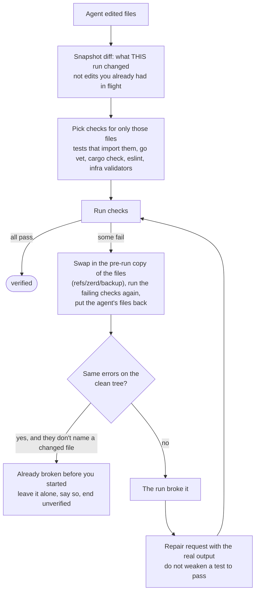

### It catches the breakage your tests can't see

Checks prove the code runs. They can't see the caller outside this repo. The **signature guard** compares each changed Python
and JS/TS file with `HEAD` and flags a dropped parameter, a newly required one, reordered positionals, a removed `*args` or
`**kwargs`, or a function that is no longer exported. The agent is sent back once to keep old calls working. It exists because
of a real miss in round 1. `agent/verify.rs`

### Every edit is checked the moment it lands

An edit result comes back with the problems *that edit introduced* attached (old and new text are both checked, and anything
already there is ignored): Python syntax and `ruff`, JSON and TOML parsing, `node --check`, `gofmt`, and for TypeScript **your
project's own `tsserver`, kept running**, so real type errors show up in the same turn at under a second after the first call.
`util/diagnostics.rs`

### It will not edit what it hasn't read

Editing an existing file the agent hasn't read this session, or that changed on disk since, is refused. A small file comes back
inside the refusal so the retry needs no extra round. If you edit a file in your editor mid-run, the agent is told and re-reads
rather than overwriting you. `tools/registry.rs`

### A reviewer who has to prove it, not just claim it

"Review my changes", "review my last 3 commits", "review PR #42" run a real pipeline: a cheap triage picks what could break,
reviewers read the diff through lenses (behaviour, approach, failures, project rules, git history, security, and a dedicated
**producer-to-consumer contracts** reviewer), and a gap pass asks what nobody checked. Then:

1. Each finding goes to a **verifier whose default is to refute it** (six at a time, it must name the exact line it read).
2. A confirmed HIGH goes to a **repro agent** that tries to make the defect happen in a sandboxed copy of the change. If it
   can't, the finding is capped at MEDIUM and shows what was tried.
3. Each claim gets a confidence score; below the cutoff it's dropped. Refuted claims are remembered per repo for two weeks.

The write-up says what was reviewed, every fallback taken (the PR base, a failed fetch), and what the reviewers *didn't* check.
Say "fix 2 and 3" and the fix run starts from the facts the review proved, must consult the **advisor** before its first edit,
and ends with a fresh verifier in a scratch worktree that never saw the author's reasoning. `agent/review_pipeline.rs`

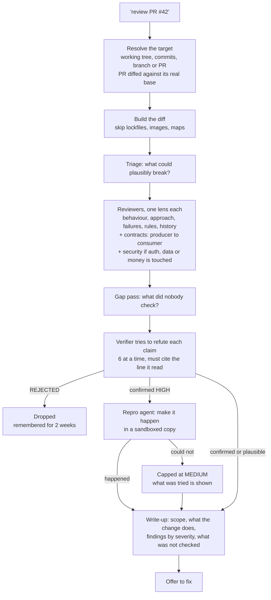

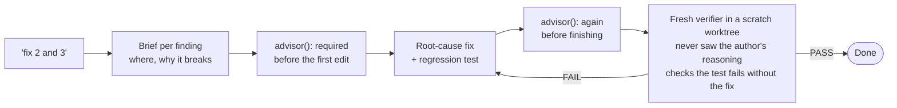

### A hallucination check that isn't a model

Every `path` and `path:line` in the final answer is looked up in the real tree. An invented file or a line past the end of one
goes back for one correction; whatever's left is shown as a warning. A few dozen lines of code. `agent/grounding.rs`

### It argues with your plan before building it

For risky requests ("should we...", a migration, "replace X with Y"), a read-only **challenger** on a *different model family*
argues against it first. Each objection is tagged `verified` (with a real `file:line`), `plausible` or `guess`; an objection
that cites a file that doesn't exist is dropped, never shown. `agent/challenge.rs`

### It finds code without reading everything

Cheapest evidence first: `search` (BM25-ranked files, camelCase-aware, boosted by files that fixed similar requests before),
`outline` (symbols with line ranges), `read_file(symbol=...)` (one function, not the file), then `grep`. For structure there is a
**live symbol graph** built with tree-sitter for TS/JS, Python, Rust, Go, Java, C#, PHP and Ruby: `callers`, `callees`, `impact`,
`trace`, `path`. It reads the working tree, so it never goes stale, and an edit that changes a signature comes back with the
places that use it. See what the model would see: `zerd graph callers parse_invoice`. `util/symgraph.rs`

### It doesn't pay twice for the same tokens

- `read_file` remembers which lines the model has seen and returns **only new lines, or a diff** when the file changed.
- The same read-only lookup with nothing written since is answered in one line instead of repeating the output.
- Big tool output is capped and archived (`r7`), and the model can pull any range back with `recall_result`.
- **Read-only calls start running while the model is still writing the rest of its reply.**
- Compaction asks the same model, on the exact prefix it just sent, so the provider serves the summary **from cache**. Recent
  turns stay word for word, the files being worked on are restored from disk, and the replaced messages are saved to
  `transcripts/` so nothing is lost. Three compactions in a row that refill immediately trip a breaker that prunes instead.
- Folder rules (`apps/web/AGENTS.md`) attach on the first touch of that folder and again after a prune clears them.
- With more than 15 MCP tools, only names are sent until the model asks for the ones it needs (`tool_search`).

`/cost` shows where tokens went, weighted by how many later calls re-sent each result, and tells you why a cache miss happened.

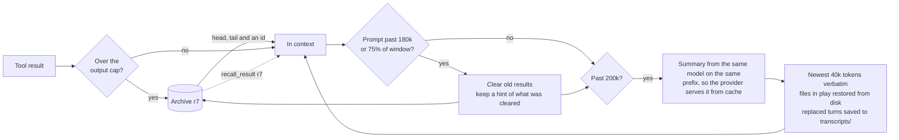

### It knows how much work a task should take

Before each request the model names how many tool rounds it needs. Afterward that guess is scored (`+10` on target, minus
points over, `-25` if the hard stop at 3x cut it off) and the last results are shown to it next time. A loop, a repeated
action, or an edit that keeps being rewritten triggers a nudge, then escalates to the strong model, then stops instead of
burning the budget. Out of time or tokens, one last tool-free call turns what it learned into an answer, and any checks still
run against the tree it left. `agent/ledger.rs`, `context/loop_detector.rs`

### It remembers only what can't be invented

Memory is what *you* said and what *verified* runs changed. A correction ("no, not that", "yes, exactly like that") becomes a
lesson written into your own `AGENTS.md` under `## Learned by zerd`, where you can read, edit and commit it. `/forget N` removes
one. `zerd learn-import --repo .` mines your past Claude Code sessions for rules, weighing each against what `AGENTS.md`
already says. `agent/learn.rs`

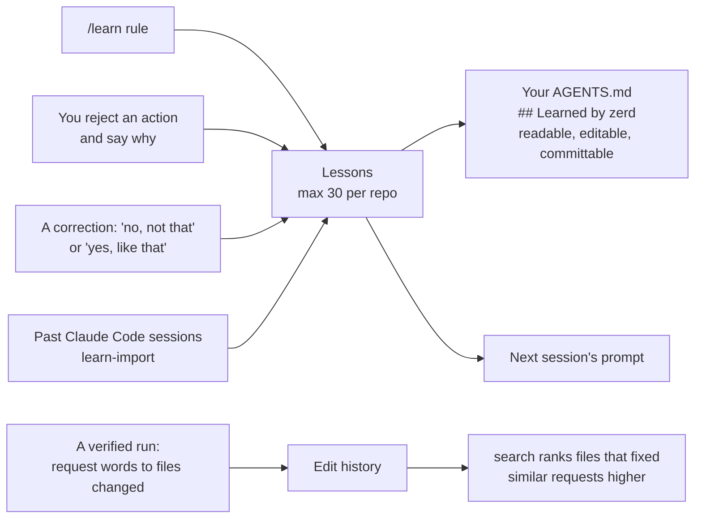

### Undo that doesn't touch your git state

Before each request the working tree is recorded as a commit object under `refs/zerd/backup` (no stash, no index change).
`/undo` restores what the last request changed and removes the files it created. Files that were untracked before are never
deleted. `/rewind` goes back up to 20 requests.

## Works with the model you can afford

Open and cheaper models are good at the hard 80% and sloppy at the mechanics: a wrong tool name, a stringified argument, a
reply that ends mid-sentence. A frontier model barely notices. A cheaper one burns rounds on it. zerd absorbs those in code:

| What the model does | What zerd does |
|---|---|
| Calls `Read`, `bash`, `str_replace` | Maps it to `read_file`, `shell`, `edit` |
| Sends `old_str`, `file_path`, `newString` | Renames to the real parameters |
| Sends a list of edits as a JSON *string*, or one edit instead of a list of one | Parses it |
| Writes a tool call into its answer (`<tool_call>`, `[TOOL_CALLS]`, ```` ```json ````) | Says "text is not run" and re-asks, twice at most |
| Thinks, then replies with nothing | Tells it the user saw a blank answer |
| Is cut off by the output limit | Continues exactly where it stopped; a tool call cut mid-argument is **never run** |
| Pastes code instead of writing the file | Notices no file changed and asks it to apply it |
| Only updates a doc when the bug is in code | Sends it back for the code |
| Hits a "prompt too long" in any of 20+ providers' wordings | Compacts and retries once |
| Is only *mostly* OpenAI-compatible (vLLM, llama.cpp, a company proxy) | Per-provider `compat` switches, no code |

Routing is by role (`default`, `fast`, `strong`, `summarize`, `review`, `advisor`, `challenge`), each a fallback chain.
A request is classified **without a model call** (and says why), small work goes cheap, debugging and concurrency go strong, and
a failed repair or a loop escalates. When a provider's quota runs out zerd **fails over to another provider and tells you**.
The default model is `MiniMaxAI/MiniMax-M3`; `-m` or `/model` changes it. `zerd probe-models` shows which of your configured
models answer, and `zerd insights` reads zerd's own traces to show, per model, failed calls, cache hit rate, malformed tool
calls and how often the loop had to step in, so you tune from what happened.

Built in: openai, anthropic, gemini, openrouter, groq, deepseek, mistral, xai, together, fireworks, cerebras, moonshot, zai,
ollama, lmstudio, plus Codex over the Responses API. Any OpenAI- or Anthropic-format server takes three lines of config.

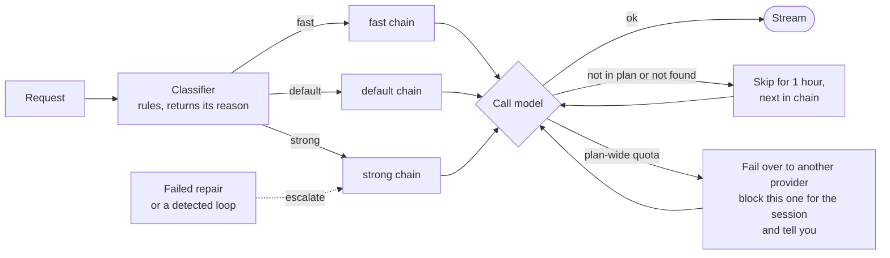

## Safety

Rules the model can't talk its way past, because they sit in the tool registry that every call passes through, for the main
agent, sub-agents and parallel workers alike.

1. **File tools** resolve the path first. `..` and symlinks that lead out of the workspace are refused.
2. **Shell commands** are scanned for paths in your home, `/etc`, other users' folders or `..` escapes and refused before they
   run. History-destroying git commands are blocked.
3. **OS sandbox** (macOS `sandbox-exec`, on by default): a command can't write outside the workspace, temp and package caches, or
   read `~/.ssh`, `~/.aws`, `~/.gnupg`, keychains, or the workspace's own `.env`, however the command reaches it.

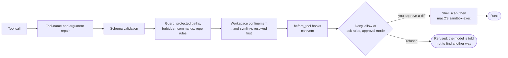

On top of that: `.env*`, `*.pem`, `*.key` and SSH keys are protected by default; permission rules use Claude Code's notation
(`Bash(git diff:*)`, `Edit(src/**)`); `web_fetch` refuses localhost, private ranges and cloud metadata at *every* redirect hop;
and **a cloned repo can't turn on code execution**: its `.zerd/config.toml` cannot enable `hooks`, `mcp_servers`,
`verify_commands`, `approval` and similar until you trust that exact file, and editing the file revokes the trust.

Approvals show a diff, and what you approve is exactly what gets written. Modes (Shift+Tab cycles): `on-request` (default),
`auto-edit`, `auto`, `plan` (read-only, ends in a plan), `never`, `on-failure`, `yolo`.

## Using it

- **Full-screen UI** with a scrollable transcript, a side panel (files read and written with lines added and removed, commands,
  todos, agents), syntax-highlighted diffs, and `ask_user` that gives you one-key choices instead of prose with lettered options.
- **Ctrl+C interrupts the agent, not the app.** Anything you type while it works steers the next step, and pauses the running checks so
  your note is handled now instead of after a slow typecheck.
- **Everything resumes.** Each turn autosaves. `zerd --continue` picks up where you left off, redrawn, with cost and trace.
- **Parallel agents.** Read-only sub-agents run concurrently (and in the background, with follow-ups). `parallel_tasks` fans
  write-capable workers into separate git worktrees, merges them in dependency order, and flags real conflicts instead of
  guessing. It only pays off for genuinely independent work.
- **Skills.** 19 short playbooks that attach by keyword with no model call (`debugging`, `security`, `refactor`, `review-pr`,
  and more). `ponytail` (do the least that fully works), `grounded` and `house-rules` are always on.
- **Automation.** `--json` prints events as JSON lines; `--rpc` takes JSON commands on stdin for editors; `--report file` writes
  run metrics.

First things to try: `review my changes`, `/cost`, `/undo`, `/help`.

## Reference

<details>
<summary><b>Configuration</b></summary>

Later layers win: flags, then the project's `.zerd/config.toml`, then the user config, then defaults.

| What | Where |
|---|---|
| Keys | environment variables or zerd's own `.env` (`/connect <provider>` saves one) |
| User config | `~/Library/Application Support/zerd/config.toml` (Linux `~/.local/share/zerd`, Windows `%APPDATA%\zerd`) |
| Project config | `.zerd/config.toml` (sensitive keys need `--trust`) |
| Data | sessions, traces, transcripts, lessons, review memory in the user folder; `ZERD_DATA_DIR` moves it |
| Instructions | `AGENTS.md` / `CLAUDE.md` in the repo and `~/.claude/CLAUDE.md`, with `@imports` followed |

```toml
[routing]
default   = ["claude-sonnet-5-5", "deepseek/deepseek-v4-pro"]
fast      = ["deepseek/deepseek-v4.1-flash"]
strong    = ["claude-opus-5-5"]
review    = ["gpt-5.6-sol"]
advisor   = ["deepseek/deepseek-v4-pro"]

[providers.work]                       # any OpenAI- or Anthropic-format server
base_url    = "https://llm.internal.example.com/v1"
api_key_env = "WORK_LLM_KEY"
protocol    = "anthropic"              # default "openai"
```

Flags: `-m`, `--approval`, `--effort low|medium|high`, `--trust`, `--add-dir`, `--challenge`, `--pi` / `--no-pi`, `-c <dir>`,
`--resume <id>`, `--continue`, `--parallel`, `--graph tasks.json`, `--json`, `--rpc`, `--report`.

</details>

<details>
<summary><b>Which safeguards run when</b></summary>

zerd behaves a little differently when you talk to it and when a script does, because a script has nobody to ask:

| | Interactive | One-shot / `--json` / `--rpc` |
|---|---|---|
| Checks on changed files | when you run `/verify` | **automatically** after edits, with repair rounds |
| Independent diff review | when you ask ("review my changes"); set `auto_review = true` to review every change | same |
| Challenger on risky requests | on | off (`--challenge` turns it on) |
| Learning from corrections | on | off |
| Approvals | `on-request` | `auto-edit` unless you pass `--approval` |
| Signature guard, read-before-edit, citation check, per-edit diagnostics, loop detection | always on | always on |

</details>

<details>
<summary><b>Extending: MCP, hooks, commands, project tools</b></summary>

- **MCP** stdio and streamable HTTP servers, gated by project trust.
- **Hooks:** `before_agent`, `after_agent`, `before_tool`, `after_tool`, `on_error`, `pre_compact`, `post_compact`,
  `session_start`, `stop` (exit 2 sends stderr back and keeps the agent working), `subagent_stop`. Whatever a `before_agent`
  hook prints is handed to the model with your request.
- **Slash commands:** markdown files in `.claude/commands` and `.zerd/commands`, with `$1`, `$@`, `${1:-default}`.
- **Project tools:** each `.zerd/tools/*.toml` becomes a tool that runs a shell command (arguments arrive as JSON on stdin and
  as `ZERD_ARG_<NAME>`).
- **Prompt:** `.zerd/APPEND_SYSTEM.md` adds to zerd's prompt, `SYSTEM.md` replaces it.
- **Repo profiles:** `profiles/<name>.toml` carries per-project instructions, forbidden paths and commands, and verify rules.
  `profiles/tunyt.toml` is a worked example.

Commands: `/help /clear /compact /context /cost /model /effort /approval /permissions /plan /challenge /verify /diff /agents
/hooks /skills /config /stats /tools /mcp /connect /save /sessions /resume /checkpoint /restore /undo /rewind /jobs /copy
/learn /forget /layout /exit`.

</details>

<details>
<summary><b>Windows notes</b></summary>

zerd runs on Windows 10/11 (x64). Shell commands run in **Git Bash**, so the bash a model writes for Mac and Linux works
unchanged; without Git for Windows it falls back to PowerShell. The OS sandbox is macOS only, so on Windows you have the confined
file tools and the shell path scan. That scan looks for Unix-style paths, so a command naming a `C:\...` path outside the project
isn't caught the way `/etc/passwd` is. CI builds and tests on Windows but the Windows test run is reported, not required yet. Use
Windows Terminal; `ZERD_PLAIN=1` gives the classic scrolling layout.

</details>

<details>
<summary><b>Tests</b></summary>

```bash
cargo test        # about 550 tests, no network, no real model, around 20 seconds
```

Every test uses a scripted model (`src/tests/fakes.rs`) and a throwaway data folder, so no API credits are spent and nothing
touches your real sessions or keys. About 28k lines of Rust plus 8.6k lines of tests.

</details>

## Where zerd is not there yet

- **The OS sandbox is macOS only.** Linux and Windows get the confined tools and the shell path check, not the kernel layer.
- **No image input** (pasting a screenshot) and no IDE extension.
- **Signature checks cover Python and JS/TS.** Python outlines use an indentation-based reader, not a real parser. Diagnostics
  come from `tsserver` for TypeScript and quick checkers elsewhere, not a general language server.
- **Token counts are estimated** (bytes / 4), not counted exactly.
- **The benchmarks are small.** One project and one run each in round 2; 11 tasks in round 1, taken on the earlier Python
  version. They show where verification pays off, not a ranking. The design is tuned on one real repo, so treat defaults as
  measured there.
- **A tool that checks its work is still software.** zerd's webhook report lists its own open risks. It's more useful when the
  agent says what it didn't verify, and that goes for this README too.

## License

zerd is source-available, not open source. You can run it for any purpose, including commercial use, and redistribute
unmodified official binaries. You cannot copy, modify, redistribute or reuse the source. See [LICENSE](LICENSE).
