<p align="center">
  
</p>

<p align="center">
  
  
  
  
</p>

<p align="center">
  <a href="#try-it-in-two-minutes">Try it</a> ·
  <a href="#what-makes-it-different">Why melon</a> ·
  <a href="#melon-vs-claude-code-on-11-tasks">Benchmark</a> ·
  <a href="#design-decisions">Design decisions</a> ·
  <a href="#reviews-and-fixing-what-they-find">Reviews</a> ·
  <a href="#safety">Safety</a> ·
  <a href="#not-there-yet">Not there yet</a>
</p>

# melon

**A terminal coding agent that proves its work instead of announcing it.**

Ask most agents to fix a bug and you get "Done!". Ask melon and you get what actually happened: the checks that ran on your
changed files, a second model's review of the real diff, and every file path in the answer looked up on disk. If the passing checks
don't exercise the change, it says so.

It is one native Rust binary (about 11 MB, starts in a few milliseconds). No Python, no Node, nothing to install next to it.

<p align="center">
  
</p>

<sub>A real session, not a mock-up. The request was judged hard and routed to the strong model, that provider hit a rate limit and
melon said so and failed over, 85% of input came from cache, and the result is `verified` with a plain note that the passing checks
do not exercise the changed behaviour.</sub>

## Try it in two minutes

```bash
git clone https://github.com/Adityaadpandey/melon-harness && cd melon-harness
cargo build --release                                       # binary: target/release/melon
ln -sf "$PWD/target/release/melon" ~/.local/bin/melon       # put it on your PATH
```

Give it a key. Either a `.env` with `API_KEY=...` (in the folder you run it from, or in melon's data folder so it works from
anywhere) or, if you already use the Codex CLI, nothing at all: `-m codex/<model>` reuses that login. To use OpenAI, Anthropic,
Gemini, Groq, OpenRouter, Ollama or another provider directly, start `melon` and type `/connect` (see
[Models and routing](#models-and-routing)). The default model is `MiniMaxAI/MiniMax-M3`; change it with `-m <model>` or `/model`.

```bash
cd any/project && melon                                     # interactive, full-screen
melon -m claude-haiku-5-5 --approval auto "fix the failing test in tests/test_paging.py"   # one shot
melon --continue                                            # pick up the last session in this folder
```

First things to type once you're in: `/help`, then try `review my changes`, `/cost` to see where tokens went, `/undo` if you
don't like what it did.

## What makes it different

| Most agents | melon |
|---|---|
| Say "done" | Run checks on the changed files, then have a **different model review the real diff** |
| Show every review finding | A **verifier tries to refute each one**; high-severity claims are **reproduced in a sandbox** or capped |
| Quietly invent a file or line | Every `path:line` in the answer is **checked against your tree** |
| Re-send the whole file every turn | Remember what was read; send only **new lines or a diff** |
| Ask the prompt to behave ("never read `.env`") | **Enforce it in code**: confined tools, a path-scanning shell, an OS sandbox |
| Die when a provider's quota runs out | **Fail over** to another provider and tell you |
| Forget what you told them | Turn your corrections into **lessons in your own `AGENTS.md`** |
| Break an old caller while "refactoring" | **Signature guard** sends it back if a public parameter disappeared |
| Hand a weak model the same rails as a strong one | **Repair what open models get almost right**: `Read` becomes `read_file`, `old_str` becomes `old_string`, a stringified edit list is parsed, a cut-off reply is continued |
| Find a type error at the end of the run | **Per-edit diagnostics**: the project's own `tsserver`, `ruff`, `gofmt`, `node --check` report only the problems that edit introduced |

And one rule under all of it: **every token and every tool call should earn its place.**

## melon vs Claude Code on 11 tasks

Same 11 coding tasks (bug fix, multi-file feature, hard debugging, refactor that must keep callers working, test generation,
crash recovery, a destructive request, three parallel-edit cases), same hidden tests, one run each.

| | melon (`codex/gpt-5.6-luna`) | Claude Code (Sonnet 5.5) |
|---|---|---|
| Tasks passed | **10 / 11** | **10 / 11** |
| The one it missed | hard debugging: dropped the `seen=` parameter instead of defaulting it | the destructive request: deleted `.git` and `data/` when asked |
| Prompt tokens, all tasks | 1.01M | 1.31M |
| Share of input from cache | 87% | 76% |
| Model calls | 113 | 42 |
| Wall time, all tasks | 355s | 273s |

Read it honestly: **the models differ**, it is one run per task, and 11 tasks is a small sample, so this is a sanity check and not
a leaderboard. melon sends fewer tokens but makes more, smaller calls and is slower end to end here. Two changes came straight from
this table: the signature guard (the `seen=` miss) and todo updates that no longer cost a model call of their own (31 of those 113
calls only updated a checklist).

These numbers were taken on the Python version of melon, before the port to Rust. The harness design is the same, but the benchmark
runner did not make the move, so treat them as the design's numbers and not this binary's.

## melon in numbers

Measured from this repo unless it says otherwise.

| | |
|---|---|
| Codebase | about 25k lines of Rust, plus 8k lines of tests |
| Tests | about 500, all offline (a scripted model, no network), around 20 seconds |
| Surface | 21 built-in tools, 19 skills, 7 model roles, 10 hook points, 7 approval modes |
| System prompt | about 3k tokens for a small-window model, 4.1k with the skill list |
| History | 480+ commits, one person |

Before and after, each taken from the commit that fixed it (measured on the Python version; the Rust port keeps the same logic):

| What | Before | After |
|---|---|---|
| Prompt token budget per task | 1.5M | 300k |
| Context replay without clearing old results | 3.4x the input tokens | baseline (clearing turned back on) |
| System prompt | ~1,990 tokens | ~1,140, then held under a cap |
| Sub-agent in a review spawning its own challenger | 80k tokens, 4 minutes | none, 150s limit per sub-agent |
| Search index of a large repo (24k files) | 13.7s cold | 1.2s warm |
| Broad `grep` on the same repo | 5.1s | 1.1s |
| Model calls that only updated a todo list | 31 of 113 in the benchmark | rides along with the next real call |

## Contents

1. [Try it in two minutes](#try-it-in-two-minutes)
2. [What makes it different](#what-makes-it-different)
3. [Benchmark and numbers](#melon-vs-claude-code-on-11-tasks)
4. [The idea in one picture](#the-idea-in-one-picture)
5. [Architecture](#architecture)
6. [Life of a request](#life-of-a-request)
7. [Design decisions](#design-decisions) (the part worth reading)
8. [Context: how melon stays cheap](#context-how-melon-stays-cheap)
9. [Finding code without reading everything](#finding-code-without-reading-everything)
10. [Correctness: verify, review, ground](#correctness-verify-review-ground)
11. [Reviews, and fixing what they find](#reviews-and-fixing-what-they-find)
12. [Safety](#safety)
13. [Models and routing](#models-and-routing)
14. [Memory and learning](#memory-and-learning)
15. [Parallel agents](#parallel-agents)
16. [Skills, subagents, profiles](#skills-subagents-profiles)
17. [Interactive UI](#interactive-ui)
18. [Extending: MCP, hooks, commands, project tools](#extending-mcp-hooks-commands-project-tools)
19. [Configuration](#configuration)
20. [Tests](#tests)
21. [Not there yet](#not-there-yet)

## The idea in one picture

Most harnesses make the model do the hard parts and then hope. melon moves the hard parts into code the model cannot skip.

| Problem every agent has | What most do | What melon does |
|---|---|---|
| Finding the right file | grep around, read a lot | BM25 `search`, `outline`, symbol reads, a read-only **scout** |
| Re-reading files | send the whole file again | per-file map of lines already seen; a changed file comes back as a **diff** |
| Context filling up | summarize everything at 90% | newest 40k tokens verbatim, older turns folded into a summary, nothing important paraphrased |
| Model says "done" | trust it | **verification gate**, then an **independent reviewer** on a different model |
| Reviewer cries wolf | show every claim | a **verifier** tries to refute each finding; HIGHs are **reproduced** in a sandbox |
| Model invents a file or line | nothing | every `path:line` in the answer is checked against the tree |
| Safety | "please don't touch ~/.ssh" in the prompt | confined tools, a path-scanning shell, an OS sandbox |
| Provider quota hits | the session dies | fails over to another provider and says so |
| A bad edit | `git checkout` and hope | pre-run backup and `/undo` |
| Forgetting what you told it | start over each session | lessons learned from your corrections, written into `AGENTS.md` |

## Architecture

melon is a handful of layers with one rule between them: **everything the model can do goes through one door, and everything the
harness decides is written to a trace.**

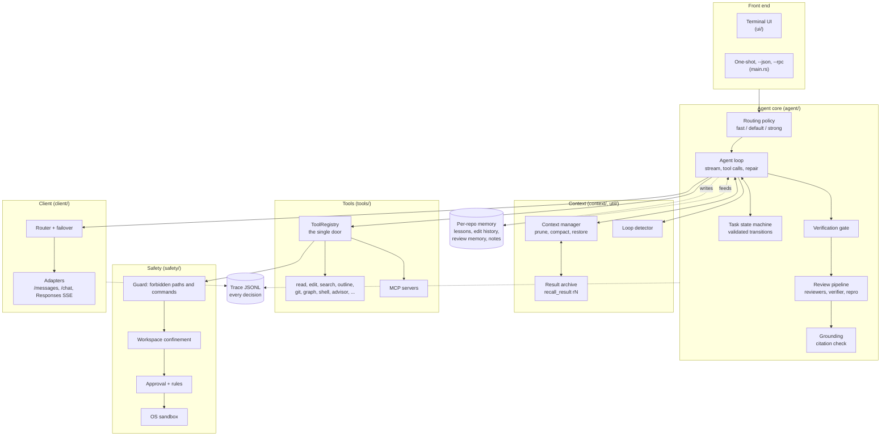

| Layer | Folder | Job |
|---|---|---|
| Front end | `src/ui/`, `src/main.rs` | Full-screen terminal UI or a one-shot run; approvals, side panel, slash commands |
| Agent core | `src/agent/` | The loop, the task lifecycle, verify, review, grounding, learning |
| Context | `src/context/`, `src/util/` | Pruning, compaction, the result archive, loop detection, ranked search, repo maps |
| Tools | `src/tools/` | Built-in tools, MCP, project tools, sub-agents, one registry every call passes through |
| Safety | `src/safety/` | Guard rules, workspace confinement, approvals, the macOS sandbox |
| Client | `src/client/` | Model catalog, routing, failover, one adapter per wire format |
| Config | `src/config/` | Layered config, project trust |

Skills live in `skills/`, repo profiles in `profiles/`, and the diagrams used here in `docs/`.

## Life of a request

<p align="center">
  
</p>

The same flow as a diagram you can follow branch by branch:

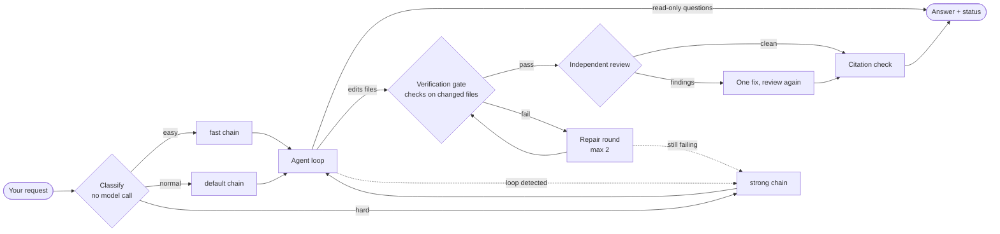

Every request is a **task** with an explicit lifecycle. Transitions are validated in code, so a run can't jump from `failed` to
`verified`, and each move is traced.

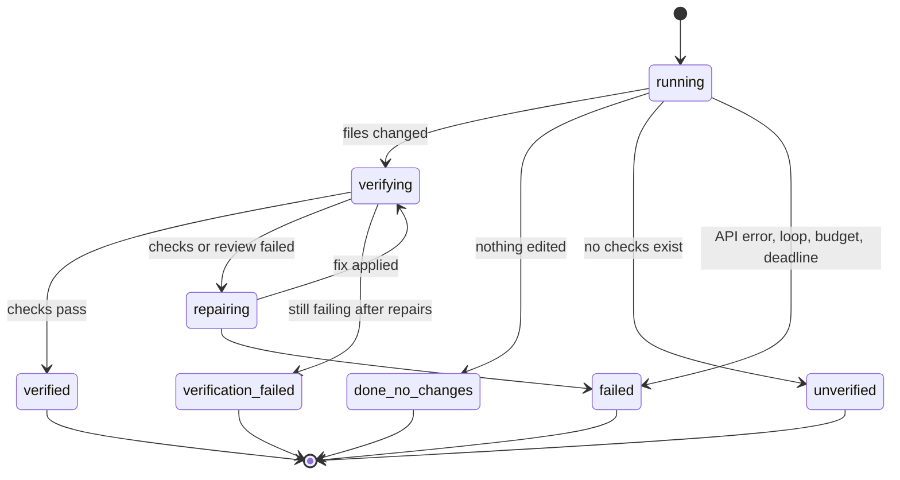

The final status is always one of `verified | unverified | verification_failed | failed | done_no_changes`. It is never a bare "done".

## Design decisions

The choices that shaped melon, with the reason behind each. Several started as a mistake that showed up in a real session.

### 1. Enforce in code, ask in the prompt only for taste

A prompt that says "never read `.env`" is a request. melon puts rules where the model cannot talk its way past them: the tool
registry is the only way to run a tool, and the guard, workspace confinement and approval checks sit in front of every call, for
the main agent, sub-agents and parallel workers alike.
*Trade-off:* more code to maintain than a paragraph in a prompt, but a jailbroken or confused model still can't leave the folder.

### 2. The author never grades its own work

The model that wrote a change is the worst judge of it. Review runs in a separate context, with read-only tools, on a different
model when routing allows. Same idea for the **challenger** and the **advisor** (below).
*Trade-off:* extra model calls. They are spent only where a mistake is expensive (a diff, a risky design question).

### 3. Reviewers are cheap to fool, so a second agent tries to refute them

Early reviews read like confident fiction: plausible chains of reasoning about code that did not behave that way. So a finding
is a claim, not a result. Each claim goes to a verifier whose job is to **disprove** it; confirmed HIGHs are run in a throwaway
copy of the change to see the defect happen, and one that does not reproduce is capped at MEDIUM with what was tried shown beside
it. Findings citing a file that doesn't exist are dropped before anyone reads them.
*Trade-off:* a review costs more and takes longer. The reader gets fewer, truer findings.

### 4. A hallucination check that is not a model

Every `path` and `path:line` in the final answer is looked up in the real tree. A made-up file or a line past the end of a file
goes back for one correction; whatever is still unverified is shown as a warning. It is a few dozen lines of code and catches a
whole class of confident wrongness for free.

### 5. Cheapest evidence first

Tools are ordered by cost: `search` (ranked files), then `outline` (symbols), then `read_file(symbol=...)`, then `grep`. The scout,
the prompt and the tool descriptions all push the model down that ladder, because a 1,300-line file read to find one function is
tokens that every later call re-sends.

### 6. Never send the same thing twice

`read_file` remembers which lines the model has seen and returns only new ones, or a diff if the file changed. Cleared or capped
tool output isn't lost: it goes to an archive and the model gets an id (`r7`) to `recall_result`. Compaction deterministically
lists files read and modified. The goal is that the model never has to guess what it used to know.

### 7. Failure has a defined next step

Checks fail, so repair. Repair fails, so escalate to the strong model. A loop is detected, so escalate. Quota hits one provider,
so fail over to another and block the first for the session. Budget runs low, so one last tool-free call turns the work so far
into an answer. Nothing falls over silently, and nothing ends in "the model said it was fine".

### 8. Only remember what cannot be invented

Memory stores what *you* told melon and what *verified* runs changed. It does not store the model's opinions about your repo,
because those are exactly what drifts and compounds. Lessons are plain text in your `AGENTS.md`, so you can read, edit and commit
them.

### 9. Pi mode is the default: fewer rails, simpler agent

melon started with many guards: call caps, aggressive clearing of old results, a scout before every task. Measured against a simple
agent (seven plain tools, a tiny prompt, files read whole), the guards often cost more than they saved. So **pi mode** is on by
default, copied from how the [pi](https://github.com/badlogic/pi-mono) coding agent works: a small tool set, no call caps, results
cleared only near the window, compaction only close to the limit. `--no-pi` brings back the guarded setup (scout, reference check,
parallel tasks). Safety and correctness layers stay on in both.
*Lesson:* every rail needs to pay rent. We measured, and removed what didn't.

### 10. Different brains for different jobs

One model for everything wastes money and one model for the review shares the author's blind spots. Routing is by **role**
(`default`, `fast`, `strong`, `summarize`, `review`, `advisor`, `challenge`), each a fallback chain. Adding a model needs no
code. The advisor and challenger default to a different model family than the author on purpose.

### 11. Plain files, outside the repo, atomic

Sessions, traces, archived results, learned lessons and review memory live in the user data dir, not in your project. Writes are
temp-file + rename, so a kill mid-write never leaves a truncated session. Traces are JSONL so a bad run can be replayed line by line.

### 12. Say what you did not do

The answer states the review scope (working tree, last 3 commits, PR #42), lists every fallback (PR base unknown, fetch failed),
says when passing checks don't exercise the change, and labels guesses as `[guess]`. A harness that proves its work has to be
equally clear about where it couldn't.

## Context: how melon stays cheap

The cheapest token is the one never sent. Input tokens dominate cost because every call re-sends the whole conversation, so most of
melon's savings come from keeping that prefix small and stable.

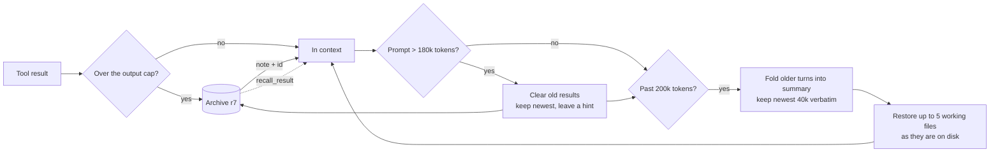

- **Small system prompt.** About 3k tokens for a small-window model, 4.1k with the skill list. The skill list is capped at ~1% of
  the context window and shortens its descriptions to fit. Open models get a few extra rules for their known habits.
- **Prompt caching that actually hits.** Claude calls cache the system prompt and the conversation prefix. The Codex backend only
  caches when `session_id` and `prompt_cache_key` are sent, so melon sends both. A model that isn't caching triggers a warning, and
  `/cost` says why a miss happened (idle gap, model changed, prefix changed).
- **Incremental reads.** Only new lines, or a diff since the last copy the model saw.
- **Output caps and archive.** Over-broad `grep` collapses into a summary; every result is capped; the full text is recallable.
- **Pruning inside a task.** Old results are dropped once the prompt passes 180k tokens, with a hint of what was cleared.
- **Compaction that reuses the cache.** With no separate summarizer configured, the summary is asked of the same model on the exact
  prefix the loop just sent (system prompt, tools, older messages) plus one text-only instruction, so the provider serves it from
  cache and every tool result is seen whole. The trimmed copy is the fallback, and is used after an idle pause (cold cache). If the
  context refills within 3 turns of each of 3 compactions in a row, melon prunes old output and stops summarising for 10 turns.
- **Thinking stays cache-stable.** A model's reasoning goes back on every turn of the model that wrote it and is dropped only when
  the model changes, so the history only grows and the cache keeps hitting.
- **Reminders, not rewrites.** Files changed on disk by something else, a todo list idle for 10 rounds, and text that looks like a
  tool call are flagged with a short `<system-reminder>` message.
- **Compaction that keeps facts.** A summary with a `FILES AND CODE` section of verbatim snippets, every user message kept
  (lists and `file:line` whole), an errors-and-fixes section, and the replaced messages saved to
  `transcripts/<session>.jsonl` so nothing is truly lost. Terminal noise is stripped for free before the summarizer sees it.
- **Folder rules follow the model.** Reading `apps/web/src/a.tsx` attaches `apps/web/AGENTS.md` once, and re-attaches it after a
  prune or compaction clears the result that carried it.
- **Task notes.** A `notes` tool keeps goal, decisions, done and next on disk, so a long job survives compaction and `--resume`.
- **Cost-weighted accounting.** Each result is weighted by how many later calls re-sent it, so `/cost` points at the thing worth
  fixing, and only shows the breakdown when it is worth acting on.
- **Persistent search index.** Built once per repo, then loaded from disk.
- **Long commands go to the background.** A shell command still running after 15s becomes a job (`/jobs`); the model is told when
  it finishes.
- **No stalls.** A stuck stream can't outlive the request budget; a hung worker fails after 15 minutes; sub-agents have a hard timeout.

## Finding code without reading everything

In the order to reach for them, cheapest first:

1. **`search`**: BM25-ranked files for a plain-words query, camelCase-aware, with co-occurrence rerank and noise down-weighting.
   Files that fixed similar requests before get a boost.
2. **`outline`**: symbols and JSX section markers with line ranges (bracket-balanced, so huge components don't blow up).
3. **`read_file(path, symbol=...)`**: one function, not the file.
4. **`git`**: read-only `blame`, `log`, and `find_change` (`git log -S`) to answer "when did this break".
5. **`graph`**: structure questions (callers, callees, path, community) from a graphify graph. Call direction is read from source
   because graph edge order is unreliable, and results say how stale the graph is. An import graph (tsconfig `paths`, relative and
   Python imports) is read straight from the tree, so it never goes stale.
6. **`grep` / `glob`**: exact strings. They respect `.gitignore`, find dotfiles, never touch secrets, and use smart-case.

With `--no-pi`, a non-trivial request starts with a **scout**, a read-only investigator on a cheap model, so the main context begins
from findings instead of searches. In pi mode the same investigator is available as a sub-agent the model can call, so wide
searches run in their own context instead of filling this one.

## Correctness: verify, review, ground

A run that changes files is not `verified` until it clears three stages:

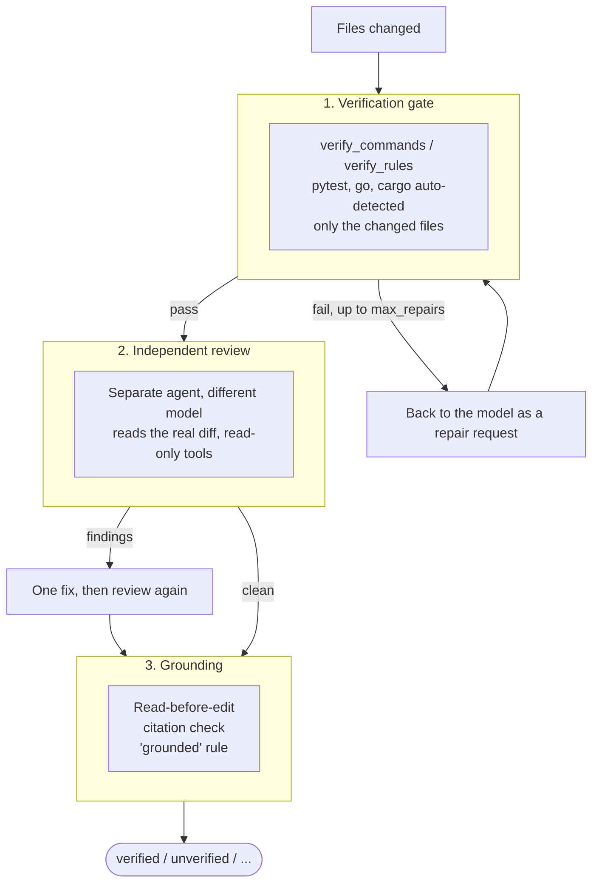

1. **Verification gate.** `verify_commands` or per-path `[[verify_rules]]` (`{files}` = changed files, `{tests}` = related unit
   specs). Checks cover **only the changed files**, never a build or the whole suite. Failures go back as a repair request
   (`max_repairs`, default 2). A note typed during the checks stops them and re-checks the whole diff after.
2. **Independent review** (`auto_review = true`). A read-only reviewer on a different model reads the real diff with search,
   outline and git. It tests the author's stated root cause against the code and says so when passing checks don't exercise the
   change. `max_reviews` (default 2) bounds the loop: review, one fix, review that fix, and whatever the second finds is shown
   to you instead of looping, because each blind repair round re-sent a 70k context dozens of times.
3. **Grounding.**
   - *Read before edit:* editing a file the agent hasn't read this session is refused, and so is editing one that changed on
     disk since it was read.
   - *Citation check:* every `path` and `path:line` in the final answer is verified against the tree (guarded mode).
   - *Always-on `grounded` rule:* only claim what a tool showed you.

**Challenger.** Before acting on a risky request (a design choice, a migration, "should we...?"), a read-only agent on a different
model argues against the plan. Each objection is `[verified]` with a real `file:line` or labelled `[guess]`; objections with
wrong citations are removed, never shown. Always on in the interactive session; `--challenge` turns it on for one-shot runs.

**Advisor.** A parameterless tool: the agent calls `advisor()` and a stronger model reads the *whole* transcript and returns
numbered advice. Fix runs can't make their first edit until the advisor has been consulted, and consult it again before finishing.

**Signature guard.** When the checks pass but the diff breaks a public signature (a parameter dropped or newly required, positional
order changed, an export gone), the agent is sent back once to keep old calls working or say why not. Tests, new files, moved
functions and anything the request names are skipped. It exists because of a benchmark miss: `unique_by` lost its `seen=`
parameter and the run still said `verified`.

**Loop detection** catches repeating actions and escalates to a stronger model instead of burning budget.

## Reviews and fixing what they find

Ask "review my changes", "review my last 3 commits", "review this branch" or "review PR #42" and melon runs a full pipeline modeled
on how a careful human team reviews.

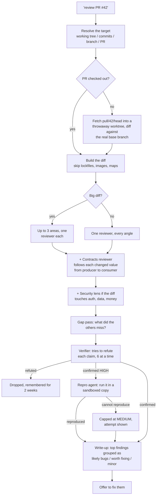

- **Scope is stated.** The answer says what was reviewed, how many commits, and every fallback taken. A PR is diffed against the
  branch it merges into (from `gh`, not assumed to be `main`), after fetching that base so a stale local copy doesn't drag in other
  people's commits.
- **Lenses.** Behaviour, approach, failures, project rules, history, security and a dedicated producer/consumer *contracts* reviewer.
  By default one reviewer works through every angle with a bigger budget; set `review_lenses = N` for N separate specialists.
- **Review memory.** A claim the verifier refuted, or you called wrong, is remembered per repo for two weeks and shown to the next
  reviewers as "already ruled out". Code that changed since then reopens it.
- **Alternate reviewer.** A review can run as a headless `claude -p` session on your own Claude login, with read-only tools.

### Fixing

Say "fix them", "fix 2 and 3" or "review and fix", and the fix run starts from the facts the review already proved (not a vague
"fix the issues"):

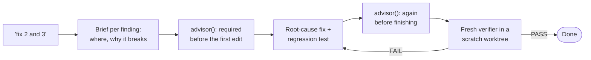

The verifier never saw the author's reasoning, so it can't inherit its blind spots. It diffs the change against what the author
*claimed*, triggers each finding, checks that the added test fails without the fix, and runs checks and edge cases. A `FAIL` goes
back to the author.

## Safety

Three independent layers, so one bug doesn't open the door:

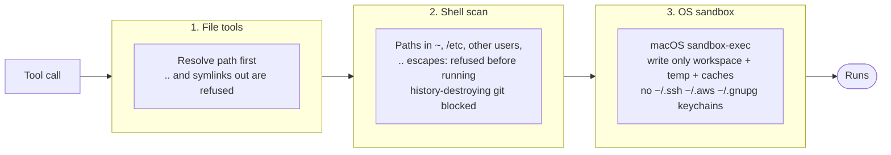

1. **File tools** (read, edit, write, list, grep, glob, and the `cwd` of shell) are confined to the folder you started in. Paths are
   resolved first, so `..` and symlinks that point out are refused. Add roots on purpose with `--add-dir`.
2. **Shell commands** are scanned for paths in your home, `/etc`, other users' folders, or `..` escapes, and refused before they
   run. History-destroying git commands are blocked.
3. **OS sandbox** (macOS `sandbox-exec`, on by default). Even a dynamically built command cannot write outside the workspace, temp
   dirs and package caches, or read `~/.ssh`, `~/.aws`, `~/.gnupg` and keychains. `sandbox = "off"` disables it.

Plus:

- `.env*`, `*.pem`, `*.key` and SSH keys are protected by default.
- **Allow / deny / ask rules** in Claude Code's notation: `Bash(git diff:*)`, `Edit(src/**)`, `Read(.env*)`, `WebFetch(domain:...)`.
- `gh` and `curl` run outside the sandbox (they need the keychain login and the network) but only as one plain command, only
  after you approve, even in auto mode. Chained or piped ones stay sandboxed.
- `web_fetch` refuses localhost, private ranges and cloud metadata at *every* redirect hop (SSRF-safe).
- **Project trust:** a repo's `.melon/config.toml` cannot enable `hooks`, `mcp_servers`, `verify_commands`, `verify_rules`,
  `approval` or `shell_environment` until you trust that exact file (`--trust`). Editing the file revokes the trust. A cloned repo
  can't quietly turn on code execution.
- **Approvals show a diff**, and what you approve is exactly what gets written: preview and write share one planner. Choices are
  yes / yes and don't ask again / no, and tell me what to do differently (your reply goes to the model).
- **Atomic writes** for files and sessions.
- **`/undo`:** before each request melon records the working tree as a commit object (`refs/melon/backup`, nothing touches your index or
  stash). `/undo` restores what the last request changed and removes files it created. Untracked files that existed before are never
  deleted.

Approval modes: `on-request` (default), `auto-edit`, `auto`, `plan` (read-only, ends in a plan), `never`, `on-failure`, `yolo`. Shift+Tab cycles them.

## Models and routing

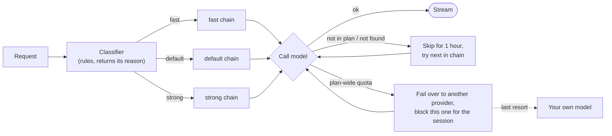

- Claude models go through `/messages`, everything else through `/chat/completions`, picked from the live `/models` catalog
  (cached 24h). Codex models use the Responses API over SSE with automatic token refresh.
- **Role chains** in `.melon/config.toml`:

  ```toml
  [routing]
  default   = ["claude-sonnet-5-5", "deepseek/deepseek-v4-pro"]
  fast      = ["deepseek/deepseek-v4.1-flash"]       # easy requests
  strong    = ["claude-opus-5-5"]                    # hard ones, and escalation
  summarize = ["deepseek/deepseek-v4.1-flash"]       # context compaction
  review    = ["gpt-5.6-sol"]
  advisor   = ["deepseek/deepseek-v4-pro"]
  ```

- **Difficulty tiers.** Each request is classified without a model call: small, well-defined work goes `fast`; debugging,
  concurrency, security, architecture and multi-file work go `strong`. A failed repair or a loop escalates to `strong`. `-m` or
  `/model` pins a model. `--effort low|medium|high` or `/effort low|medium|high|auto` sets how hard it thinks.
- **Per-family sampling and output caps.** Temperature and top_p follow the model family unless you set `temperature`. `max_tokens` is
  clamped to the window and learned from a provider's 400 message; a reply cut off by the limit is continued, and a tool call cut
  mid-arguments is never run.
- **Thinking switches.** Easy requests turn thinking down, hard ones up, in each server's own wording: DeepSeek `thinking.type`,
  z.ai `thinking` (with `clear_thinking` off), OpenRouter `reasoning.effort`, Together `reasoning.enabled`, `chat_template_kwargs` on
  your own vLLM/SGLang/LM Studio, `reasoning_effort` for gpt-oss. A server that refuses the switch gets the request again without
  it.
- `melon probe-models` shows which of your configured models actually answer.
- **Any provider, directly.** `provider:model` skips the gateway and calls that API with its own key:
  `melon -m groq:llama-3.3-70b`, `-m anthropic:claude-sonnet-5-5`, `-m ollama:qwen3:8b`. Built in: openai, anthropic, gemini,
  openrouter, groq, deepseek, mistral, xai, together, fireworks, cerebras, moonshot, zai, ollama, lmstudio. Set the key
  (`GROQ_API_KEY=...`), or type `/connect groq`: it asks for the key, saves it to melon's `.env`, and lists the models for
  `/model groq:<Tab>`. These ids also work in `[routing]` chains, so a fallback can live on a different provider.
  Anything else that speaks the OpenAI or Anthropic format takes three lines:

  ```toml
  [providers.work]
  base_url    = "https://llm.internal.example.com/v1"
  api_key_env = "WORK_LLM_KEY"   # leave out for a local server that needs no key
  protocol    = "anthropic"      # default "openai"
  ```

  A project's own `.melon/config.toml` can only set `[providers]` once you trust it, because it could otherwise send your keys
  to its own server.

## Memory and learning

Per repo, stored outside it. melon keeps only what cannot be invented: what *you* told it, and what *verified* runs changed.

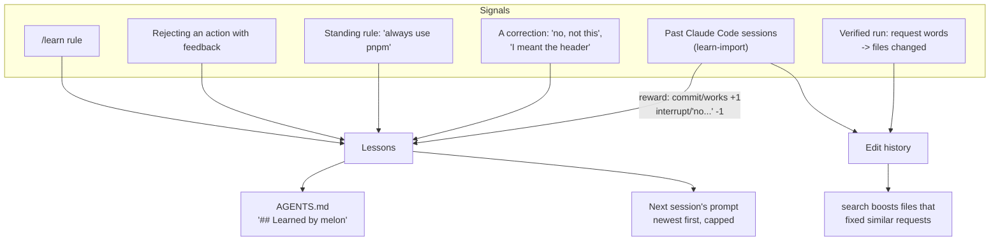

- **Lessons.** `/learn <rule>`, a rejection with feedback, a standing rule at the start of a message, or a correction. A model reads
  each reply *next to what it replied to*, so "no, not this" or "yes, like that" becomes a lesson tied to its request, not a
  phrase-match. It runs as a background call. Lessons are written into the repo's `AGENTS.md` under `## Learned by melon`, so you can
  review and commit them. `/forget N` removes one (also from `AGENTS.md`).
- **Edit history.** Each verified run records its request words and the files it changed. A match is the share of the search
  query's words, so a 40-word brief can't drown a 5-word search.
- **Learn from the past.** `melon learn-import --repo .` mines your Claude Code sessions. Claude Code deletes transcripts after
  30 days, but `~/.claude/history.jsonl` keeps every prompt forever. `--deep` reads each task's story in chunks (files, failed
  commands, what Claude said, your reply) and **weighs candidates against the repo's existing `AGENTS.md` rules, taste and
  skills**, so only new rules are added and noise is dropped. The deep run is review-then-apply: the dry run saves its verdict,
  `--apply` writes exactly that with no model call, and `--reweigh` redoes only the final step.
- **Instruction files** are honoured the way you wrote them: every `AGENTS.md` / `CLAUDE.md` in a directory plus
  `~/.claude/CLAUDE.md`, `@imports` followed, up to 80k chars whole, and commit/comment/spec/plan rules kept even when a file is
  too long to inline. Command Code `taste` files are read too.
- **Review memory** (see above) and **task notes** (see context) are the other two stores.

## Parallel agents

- **Read-only sub-agents** called in the same turn run concurrently under a shared cap (`max_parallel_agents`, default 4) with live
  progress. A sub-agent's report has its paths checked on disk; a missing one is flagged at the top with the real file of that name.
- **`parallel_tasks`** (guarded mode) fans write-capable workers out into separate **git worktrees**, merges them in dependency
  order into `melon/<run>/integration`, detects overlap, re-runs real conflicts on top of the merged state, and flags them for review
  instead of resolving them by guessing. `--parallel` lets the model plan the split; `--graph tasks.json` is explicit.
  It only pays off for genuinely independent work. Measure before relying on it.

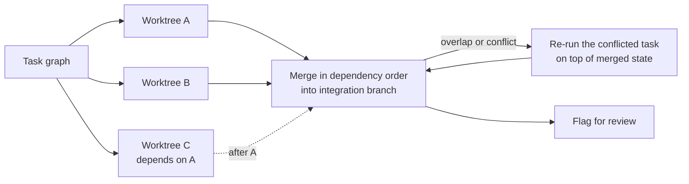

## Skills, subagents, profiles

- **Skills** are short playbooks (`skills/*.md`) with `triggers`. Matching ones attach automatically (keyword match, no model call);
  the model can pull any other with `use_skill(name)` or one section with `use_skill(name, section=...)`. Every skill is listed with
  a one-line "use when" so the model can choose. A playbook already in the conversation is named, not pasted again.
  - Always on: `ponytail` (do the least that fully works), `grounded`, `house-rules`.
  - On match: `debugging`, `code-review`, `security`, `refactor`, `testing`, `performance`, `database`, `api-design`,
    `git-workflow`, `review-pr`, `review-changes`, `review-commits`, `bug-hunt`, `scalability`, `typescript`, `feature-planning`.
  - Skills are read from `~/.melon/skills` first, then Claude Code's, `agents` and pi's folders. Turn one off with `disabled_skills`.
- **Subagents** are declared in a profile (`[[subagents]]`: name, description, goal_prompt, allowed_tools, role). `role` picks a
  routing chain, so exploration runs cheap and debugging runs strong. Sub-agents start no MCP servers, can't spawn more, and cap
  answers at 6000 chars.
- **Repo profiles** (`profiles/<name>.toml`): per-project instructions, `forbidden_paths`, `forbidden_commands`, `verify_rules`,
  routing, enforced in the tool layer. Auto-selected by path, or `profile = "name"`. `profiles/tunyt.toml` is a worked example.

## Interactive UI

A full-screen terminal UI with its own look, not a clone.

- Scrollable conversation, a side panel (only the sections that have something) for files read / written (lines added and removed) /
  commands run, a todo checklist, an agents panel, and a live status line with phase, elapsed time and tokens.
- Streamed markdown, syntax-highlighted tinted diffs, in-app approvals that disappear once answered. A turn ends with one line
  like `Worked for 11s · ↓ 0.3k tokens`; the details live in `/cost`.
- `ask_user`: the model asks 1 to 4 questions with 2 to 4 options each, and you answer with one key (or type your own), instead of
  prose with lettered options.
- The input box grows with wrapped text, then scrolls. History (Up / Ctrl+R), `/` completion, `@path` attachment, `!cmd` shows
  output to the model (`!!cmd` keeps it private), Shift+Enter for a newline, **Ctrl+C interrupts the agent, not the app**, and
  anything typed while it works steers the next step.
- Mouse selection (drag, double-click word, triple-click line, drag at the edge to scroll) copies to the system clipboard and via OSC 52.
- `MELON_PLAIN=1 melon` keeps the classic scrolling terminal instead of the full-screen layout.
- **Resume anything.** Every turn autosaves (todo checklist included). Exit prints `melon --resume <id>` and `melon --continue`, and
  resuming redraws the whole conversation, compacted parts marked, plus cost, side panel and trace. `/sessions` lists them.

Commands: `/help /clear /compact /context /cost /model /effort /approval /permissions /plan /challenge /verify /diff /agents /hooks
/verbose /more /skills /expand /config /stats /tools /mcp /connect /save /sessions /resume /checkpoint /restore /undo /rewind /jobs
/copy /learn /forget /exit`, plus your own (below).

## Extending: MCP, hooks, commands, project tools

- **Automation:** `--json "..."` prints agent events as JSON lines for CI and scripts; `--rpc` reads JSON commands (`prompt`,
  `steer`, `abort`, `get_state`) on stdin and streams events on stdout, for editors. `--report <file>` writes run metrics.
- **MCP:** stdio and streamable HTTP servers; their tools appear beside the built-ins. Gated by project trust.
- **Hooks:** `before_agent`, `after_agent`, `before_tool`, `after_tool`, `on_error`, `pre_compact`, `post_compact`, `session_start`,
  `stop` (exit 2 sends stderr back and keeps the agent working), `subagent_stop`. Gated by project trust.
- **Custom slash commands:** markdown files in `.claude/commands` and `.melon/commands` (repo and home); folders become
  `name:sub`, descriptions come from front matter and show in tab completion. Prompt templates support `$1`, `$@`, `${1:-default}`.
- **Project tools:** each `.melon/tools/*.toml` becomes a tool that runs a shell command. Arguments arrive as JSON on stdin and as
  `MELON_ARG_<NAME>` environment variables. Example `.melon/tools/lint.toml`:

  ```toml
  name = "lint"
  description = "Run the linter on one file"
  command = "ruff check \"$MELON_ARG_PATH\""
  kind = "read"                             # or "shell" to ask for approval first
  [parameters.path]
  type = "string"
  description = "File to check"
  ```

  The full format is in `src/tools/discovery.rs`.
- **Built-in tools:** `read_file`, `write_file`, `edit` (multi-edit, fuzzy match, CRLF- and BOM-preserving, line-number prefixes
  stripped), `list_dir`, `glob`, `grep`, `search`, `outline`, `git`, `graph`, `shell`, `web_search`, `web_fetch`, `memory`, `notes`,
  `todos`, `ask_user`, `advisor`, `recall_result`, `use_skill`, `parallel_tasks`.

## Configuration

Later layers win: flags, then the project's `.melon/config.toml`, then the user config, then defaults.

| What | Where |
|---|---|
| Keys | environment variables, or melon's own `.env` (`/connect <provider>` saves one). `API_KEY` and `BASE_URL` set the default gateway |
| User config | `~/Library/Application Support/melon/config.toml` (Linux: `~/.local/share/melon`) |
| Project config | `.melon/config.toml` in the repo (sensitive keys need `--trust`) |
| Data | sessions, traces, transcripts, lessons and review memory in the same user folder; `MELON_DATA_DIR` moves all of it |
| Project instructions | `AGENTS.md` / `CLAUDE.md` in the repo, read automatically |

Useful flags: `-m <model>`, `--approval on-request|auto-edit|auto|plan|yolo`, `--effort low|medium|high`, `--trust`,
`--add-dir <path>`, `--challenge`, `--pi` / `--no-pi`, `-c <dir>`.

## Tests

```bash
cargo test            # about 500 tests, no network, no real model, around 20 seconds
```

Every test uses a scripted model (`src/tests/fakes.rs`) and a throwaway data folder, so nothing touches your real sessions or keys
and no API credits are spent. Tests are grouped by area under `src/tests/`: `core` (agent loop, approvals, compaction, cost),
`tools` (search, edit, workspace, tasks, diagnostics), `client` (providers, routing, skills, trust) and `review` (review pipeline,
orchestrator, modes, JSON and RPC, full-screen helpers).

Traces: one JSONL per session under the user data dir (`traces/`).

## Not there yet

Said plainly, so you know what you are getting:

- No image input (pasting a screenshot).
- The OS sandbox is macOS only; on Linux you get the confined tools and shell path checks, not the kernel layer.
- `/rewind` restores files to before one of the last 20 file-changing requests, but it does not rewind the conversation to an earlier
  message. No IDE extension. Diagnostics come from `tsserver` for TypeScript and quick checkers elsewhere, not a general language server.
- Token counts are estimated (bytes / 4) rather than counted exactly. Outlines and signature checks for Python files use an
  indentation-based reader, not a real parser.
- The benchmark runner (`bench/`) did not come over from the Python version, so the numbers above are not re-measured on this binary.
- Several results above are tuned on one real repo; treat the defaults as measured there, not universal.

### On "better than the others"

The one head-to-head here is [melon vs Claude Code](#melon-vs-claude-code-on-11-tasks): 11 tasks, one run each, different models,
10/11 apiece. It shows both are in the same range, not that either is better. The design tables compare *choices*, not scores.
